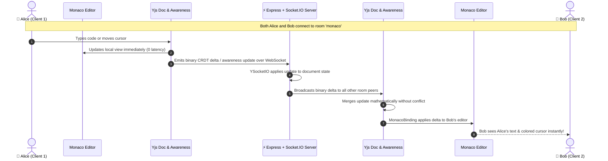

# 🚀 OmniCollab — Real-Time Collaborative Workspace Platform

> A full-stack, containerized real-time collaboration suite. Built with **React 19**, **Monaco Editor (VS Code engine)**, **Yjs (CRDTs)**, **Socket.IO**, **Express 5**, and **Docker**.

---

## 📖 Table of Contents
1. [Overview](#-overview)
2. [Key Features](#-key-features)
3. [Architecture & System Flow](#-architecture--system-flow)
   - [Real-Time Data Flow (CRDT + WebSockets)](#1-real-time-data-flow-crdt--websockets)
   - [Docker Multi-Stage Build Flow](#2-docker-multi-stage-build-pipeline)
4. [Technology Stack & Deep Dive](#-technology-stack--deep-dive)
   - [Summary Table](#technology-summary-table)
   - [Core Conceptual Explanations](#core-conceptual-explanations)
5. [Directory Structure](#-directory-structure)
6. [Getting Started & Installation](#-getting-started--installation)
   - [Method 1: Local Development (With Hot Reloading)](#method-1-local-development)
   - [Method 2: Standalone Production Server](#method-2-standalone-production-server)
   - [Method 3: Docker & Docker Compose](#method-3-docker--docker-compose)
7. [AWS Cloud Deployment Guide](#-aws-cloud-deployment-guide)
8. [Future Roadmap (Collaboration Suite)](#-future-roadmap)

---

## 🌟 Overview

**OmniCollab** is an extensible real-time collaboration platform designed for teams to edit code, collaborate, and share ideas simultaneously without race conditions or merge conflicts.

While currently featuring a shared code editor powered by the VS Code Monaco engine, the platform is architected to scale into an all-in-one developer collaboration suite featuring:
* 💻 **Collaborative Code Editor** (Active)
* 📁 **P2P File Sharing** (Planned)
* 🔗 **Instant Link & Clipboard Sharing** (Planned)
* 💬 **Private Ephemeral Rooms & Encrypted Chat** (Planned)

---

## ✨ Key Features

* **Conflict-Free Real-Time Editing**: Powered by Yjs Conflict-Free Replicated Data Types (CRDTs). Multiple users can type at the exact same millisecond without losing keystrokes or corrupting the document.
* **Shared Remote Cursors & Selection Highlights**: Real-time awareness protocol broadcasts cursor movement, text highlights, and colored user badges directly inside Monaco Editor.
* **Live Presence Roster**: Dynamic sidebar showing all active collaborators, their assigned color codes, and connection health status.
* **Production-Grade VS Code Editor**: Powered by `@monaco-editor/react` with full syntax highlighting, minimap, auto-indentation, and dark theme (`vs-dark`).
* **Zero-Config Dockerization**: Single-command execution with Docker and Docker Compose using multi-stage builds.
* **Cloud Ready**: Configured for deployment to AWS Elastic Container Registry (ECR) and Elastic Container Service (ECS).

---

## 🔄 Architecture & System Flow

### 1. Real-Time Data Flow (CRDT + WebSockets)

When two or more users interact in a room, synchronization follows this cycle:



---

### 2. Docker Multi-Stage Build Pipeline

The project packages both frontend and backend into a single container without polluting the production runtime with development dependencies.

```mermaid
flowchart TD
    subgraph Stage1 ["Stage 1: Frontend Builder (node:20-alpine)"]
        A[frontend/package.json] --> B[npm install]
        C[frontend source code] --> D[npm run build: Vite compiler]
        B --> D
        D --> E["Compiled bundle in /app/dist"]
    end

    subgraph Stage2 ["Stage 2: Production Container (node:20-alpine)"]
        F[backend/package.json] --> G[npm install --omit=dev]
        H[backend source code] --> I["Production App (/app)"]
        G --> I
        E -- COPY --from=frontend-builder --> J["/app/public (Static Assets)"]
        I --> K["Expose Port 3000"]
        J --> K
        K --> L["CMD: node server.js"]
    end
```

---

## 🛠️ Technology Stack & Deep Dive

### Technology Summary Table

| Category | Technology | Version | Purpose in this App |
| :--- | :--- | :--- | :--- |
| **Frontend Framework** | **React** | `^19.1.1` | Declarative UI rendering for the join screen, collaborator sidebar, status indicators, and editor container. |
| **Code Editor Engine** | **Monaco Editor** | `^4.7.0` | Powers the rich in-browser code editor (the exact engine that powers Microsoft VS Code). |
| **CRDT Engine** | **Yjs** | `^13.6.30` | High-performance Conflict-Free Replicated Data Type framework ensuring shared text consistency across all peers. |
| **Editor Adapter** | **y-monaco** | `^0.1.6` | Two-way binding between Yjs text types and Monaco models; manages remote cursor selections and markers. |
| **Real-Time Protocol** | **y-socket.io** | `^1.1.3` | Socket.IO transport adapter for Yjs syncing document operations and awareness over WebSocket namespaces. |
| **Presence Engine** | **y-protocols (Awareness)** | Included | Manages ephemeral state: user presence, usernames, cursor positions, and assigned avatar colors. |
| **Build Tool** | **Vite** | `^7.1.7` | Lightning-fast frontend compilation, bundling, and local development server with WebSocket reverse-proxy. |
| **Styling** | **Tailwind CSS** | `^4.2.2` | Modern CSS framework styling the dark-mode layout, responsive forms, and custom cursor animations. |
| **Backend Runtime** | **Node.js** | `v20-alpine` | High-performance, asynchronous JavaScript runtime. |
| **Web Framework** | **Express.js** | `^5.2.1` | HTTP web server serving static production bundles, health checks, and fallback SPA routes. |
| **Transport Layer** | **Socket.IO** | `^4.8.3` | Low-latency, full-duplex communication protocol running on top of WebSockets with fallback mechanisms. |
| **Containerization** | **Docker & Compose** | `Engine v29+` | Container image build and local multi-container orchestration. |
| **Cloud Hosting** | **AWS ECR & ECS** | Cloud | Production container registry (ECR) and serverless task runner (ECS Fargate / EC2). |

---

### Core Conceptual Explanations

#### 1. What is a CRDT (Conflict-Free Replicated Data Type)?
In traditional web apps, document changes are coordinated through a central database or **Operational Transformation (OT)** (as used in Google Docs). OT requires an authoritative server to transform character offsets in sequential order. 
* **Yjs uses CRDTs**: Every single character or block is assigned a globally unique, immutable ID (combining client ID and clock sequence). When multiple clients insert or delete text at the exact same location, the CRDT algorithm deterministically resolves the order on every device without needing server locks or central arbitration.

#### 2. Awareness Protocol (Shared Presence & Remote Cursors)
Not all real-time data needs to be permanently saved to disk. Ephemeral state — such as *“Where is Alice’s cursor right now?”* or *“What is Bob’s name?”* — is handled by the **Awareness protocol**. It broadcasts transient JSON objects across room peers. If a user closes their tab or loses internet connection, their awareness state automatically expires and their cursor disappears from teammates' screens.

#### 3. Why Multi-Stage Docker Builds Matter
In modern JavaScript applications, tools like `vite`, `@tailwindcss/vite`, and build dependencies are only needed during compilation. Keeping them in the production image bloats container size to 1 GB+. 
* With **Multi-Stage builds**, the frontend compiles inside a temporary container (`frontend-builder`), and only the lightweight compiled HTML/CSS/JS files (`/dist`) are copied into the production Node image. The resulting image is minimal, highly secure, and deploys in seconds.

---

## 📂 Directory Structure

```text
collaborative-coding-platform/
├── .dockerignore                # Excludes node_modules, dist, and local logs from Docker
├── .gitignore                   # Excludes dependencies, artifacts, and secrets from Git
├── README.md                    # Comprehensive documentation and project guide
├── aws.txt                      # AWS deployment instructions (ECR & ECS guide)
├── docker.txt                   # Notes and quick commands for Docker workflow
├── dockerfile                   # Multi-stage production container build definition
├── docker-compose.yml           # Single-command Docker Compose orchestration
├── package.json                 # Root script runner (build, start, dev)
│
├── backend/                     # Node.js + Express + Socket.IO Server
│   ├── package.json             # Backend dependencies (express, socket.io, y-socket.io)
│   ├── server.js                # Server entry point: HTTP server, Socket.IO, static host
│   └── public/                  # Production frontend build served by Express
│       ├── index.html           # Single Page Application root HTML
│       └── assets/              # Minified JavaScript and CSS bundles
│
└── frontend/                    # React 19 + Monaco Editor + Vite Frontend
    ├── package.json             # Frontend dependencies (react, @monaco-editor/react, yjs)
    ├── vite.config.js           # Vite config with WebSocket proxying to port 3000
    ├── index.html               # Frontend template
    └── src/
        ├── main.jsx             # React DOM root mounting
        └── app/
            ├── App.jsx          # Collaborative workspace, Monaco editor binding & presence
            └── App.css          # Tailwind imports and Yjs remote cursor CSS styles
```

---

## 🚀 Getting Started & Installation

### Prerequisites
* **Node.js**: v18.0.0 or higher (v20+ recommended)
* **npm**: v9.0.0 or higher
* **Docker Desktop** *(optional, for containerized run)*

---

### Method 1: Local Development
*Best for actively modifying frontend and backend code with hot-reloading.*

1. **Install backend dependencies:**
   ```bash
   cd backend
   npm install
   ```

2. **Install frontend dependencies:**
   ```bash
   cd ../frontend
   npm install
   ```

3. **Start the backend server:**
   ```bash
   # From the project root:
   npm run dev:backend
   # Server starts on http://localhost:3000
   ```

4. **In a second terminal, start the frontend dev server:**
   ```bash
   # From the project root:
   npm run dev:frontend
   # Vite starts on http://localhost:5173
   ```

5. Open your browser at **`http://localhost:5173`**. Any edits you make in the code will hot-reload instantly.

---

### Method 2: Standalone Production Server
*Best for testing the production build locally without Docker.*

1. **Build the frontend and copy it to backend/public:**
   ```bash
   npm run build
   ```

2. **Start the unified production server:**
   ```bash
   npm start
   ```

3. Open **`http://localhost:3000`** in two different browser windows or tabs to test real-time collaboration.

---

### Method 3: Docker & Docker Compose
*Best for zero-dependency execution identical to production.*

1. Make sure **Docker Desktop** is running.
2. Build and launch the container:
   ```bash
   docker compose up --build
   ```
3. Open **`http://localhost:3000`** in your browser.
4. To stop the container:
   ```bash
   docker compose down
   ```

---

## ☁️ AWS Cloud Deployment Guide

To deploy this container to AWS using **Amazon ECR** and **Amazon ECS**:

### Step 1: Authenticate Docker with AWS ECR
```bash
aws ecr get-login-password --region us-east-1 | docker login --username AWS --password-stdin <AWS_ACCOUNT_ID>.dkr.ecr.us-east-1.amazonaws.com
```

### Step 2: Build & Tag the Docker Image
```bash
docker build -t omnicollab .
docker tag omnicollab:latest <AWS_ACCOUNT_ID>.dkr.ecr.us-east-1.amazonaws.com/omnicollab:latest
```

### Step 3: Push to Amazon ECR
```bash
docker push <AWS_ACCOUNT_ID>.dkr.ecr.us-east-1.amazonaws.com/omnicollab:latest
```

### Step 4: Run on Amazon ECS (Fargate)
1. Open the **AWS ECS Console** and create a new **Task Definition**.
2. Specify the container image URI: `<AWS_ACCOUNT_ID>.dkr.ecr.us-east-1.amazonaws.com/omnicollab:latest`.
3. Set container port mapping to **`3000`**.
4. Create an **ECS Service** with an **Application Load Balancer (ALB)**.
5. Enable **Stickiness** on the target group to maintain stable WebSocket sessions.

---

## 🗺️ Future Roadmap

- [x] **Real-Time Code Editor**: Monaco Editor + Yjs + Socket.IO shared synchronization.
- [x] **User Presence & Colored Cursors**: Visual indicator of remote teammate cursors.
- [x] **Multi-Stage Dockerization**: Lightweight production container.
- [ ] **Instant File Sharing**: WebRTC / P2P file transfer directly between peers in the same room.
- [ ] **Quick Link & Clipboard Drop**: Shared clipboard to post links and snippets with one click.
- [ ] **Room Creation & Access Codes**: Custom room IDs with optional PIN protection.
- [ ] **Embedded Voice / Video / Text Chat**: WebRTC audio channels for frictionless pair programming.

---

## 📄 License
This project is open-source and available under the [MIT License](https://opensource.org/licenses/MIT).

